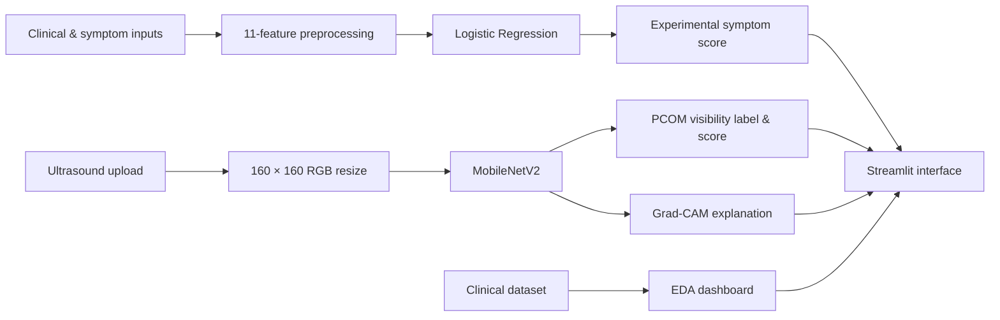

<div align="center">

# 🩺 Hybrid PCOS Analysis

### Explainable AI Research Prototype · Clinical ML + Ultrasound Deep Learning

An interactive Streamlit application combining **symptom-based machine learning**, **ultrasound morphology classification**, and **Grad-CAM visual explanations** for educational research.

[](https://www.python.org/)
[](https://streamlit.io/)
[](https://www.tensorflow.org/)
[](https://scikit-learn.org/)


**[Features](#-features) · [Architecture](#-system-architecture) · [Results](#-evaluation-results) · [Installation](#-getting-started) · [Datasets](#-datasets-and-reproducibility) · [Limitations](#important-limitations)**

</div>

> [!IMPORTANT]
> **Educational/research software only — not a medical device.** Neither model diagnoses, confirms, nor rules out PCOS. Ultrasound predictions describe whether **polycystic ovarian morphology (PCOM)** appears visible according to a dataset-specific classifier. Clinical assessment must be performed by a qualified healthcare professional.

---

## ✨ Project overview

This project explores two **separate** AI workflows within a single application:

| 🧬 Clinical symptom analysis | 🔬 Ultrasound image analysis |
|:---|:---|
| Uses **11 clinical and symptom features** | Uses a **160 × 160 RGB** ultrasound image |
| Scikit-learn **Logistic Regression** pipeline | TensorFlow/Keras **MobileNetV2** transfer learning |
| Produces an **experimental symptom-model score and score band** | Classifies **PCOM Visible / PCOM Not Visible** |
| EDA and session-based prediction analytics | **Grad-CAM** visualizes model-influential regions |

**These models were trained on different datasets.** Their outputs are displayed separately; the application does **not** perform validated patient-level multimodal fusion or a combined diagnosis.

## 🚀 Features

| Module | Functionality | Implementation |
|:---|:---|:---|
| 📝 Symptom prediction | Input demographics, menstrual pattern, symptoms and lifestyle responses | Scikit-learn prediction pipeline |
| 🖼️ Ultrasound classification | Upload JPG/PNG images to receive a PCOM visibility label and model score | MobileNetV2 with threshold **0.60** |
| 🔥 Explainable AI | Original ultrasound shown alongside a Grad-CAM heatmap | TensorFlow gradients + OpenCV |
| 📊 Clinical EDA | Class distributions, age, BMI, menstrual patterns, symptom frequencies and correlation heatmap | Pandas + Plotly |
| 📈 Session dashboard | Summarizes model scores and inputs submitted during the current session | Streamlit + Plotly |
| ℹ️ Transparent reporting | Model evaluation, assumptions, caveats and educational guidance | Streamlit About page |

## 🧭 System architecture



The ultrasound model contains its own MobileNetV2 input rescaling layer; uploaded pixels must **not** be normalized a second time. The Grad-CAM pipeline uses the corresponding image bytes so that its model score matches normal inference.

## 📊 Evaluation results

### Clinical symptom model

| Item | Recorded result |
|:---|---:|
| Source records | 541 |
| Usable records after cleaning | **539** |
| Non-PCOS / PCOS records | 363 / 176 |
| Input features | 11 |
| Model selection | 5-fold cross-validation on training partition |
| Held-out test accuracy | **83.3%** |
| Held-out balanced accuracy | **84.7%** |
| Held-out ROC-AUC | **0.899** |

### Ultrasound PCOM visibility model

| Item | Recorded result |
|:---|---:|
| Original PCOSGen training archive | 3,200 images |
| Cleaned unique development images | 3,116 |
| Development train / validation | 2,492 / 624 |
| Original official test archive | 1,468 images |
| **Screened test subset** | **1,395 images** |
| Operating threshold (chosen on validation) | **0.60** |
| Screened test accuracy | **88.10%** |
| Screened test balanced accuracy | **87.97%** |
| Screened test ROC-AUC | **0.9336** |
| PCOM-visible precision | **81.45%** |
| PCOM-visible recall | **87.50%** |
| PCOM-visible F1-score | **0.8437** |

> **Evaluation caveat:** We identified exact duplicates, contradictory labels, and near-identical images crossing the provided development and test datasets. The screened test subset removes known conflicts and 50 high-confidence development/test overlap matches, but **source- or patient-independence has not been established**. These metrics are experimental benchmarks, **not clinical or independent-generalization claims**. Test-set prevalence also differs substantially from the development distribution.

## 🛠️ Technology stack

| Layer | Tools |
|:---|:---|
| Language | Python |
| Web interface | Streamlit |
| Tabular ML | scikit-learn, Pandas, NumPy, Joblib |
| Deep learning | TensorFlow / Keras, pretrained MobileNetV2 |
| Images / Grad-CAM | Pillow, OpenCV, TensorFlow GradientTape |
| Interactive charts | Plotly |
| Local development | Windows 11, VS Code, Python virtual environment |

## 📁 Project organization

The key files in the current local implementation are:

```text
Hybrid-PCOS-Analysis/
├── app.py                         # Streamlit pages and inference UI
├── dashboard.py                   # Session dashboard and clinical EDA
├── preprocessing.py               # Symptom feature ordering/processing
├── train_model.py                 # Symptom model training and evaluation
├── train_pcosgen_mobilenet.py     # PCOM MobileNetV2 training
├── gradcam.py                     # Grad-CAM generation
├── recommendations.py             # Educational guidance
├── evaluate_pcosgen_test.py       # Official test-set evaluation
├── evaluate_pcosgen_screened.py   # Screened test evaluation
├── requirements.txt
├── README.md
├── models/                        # Saved model artifacts (if included)
│   ├── symptom_model.joblib
│   └── pcosgen_mobilenetv2.keras
├── dataset/                       # Clinical spreadsheet (local data)
│   └── PCOS_data_without_infertility.xlsx
└── datasets/                      # PCOSGen images/manifests (local data)
    └── pcosgen_train/
        ├── images/
        └── splits/
            ├── train_manifest.csv
            └── val_manifest.csv
```

**Note:** Dataset folders, archives, virtual environments, temporary outputs and model backups need not be committed. If the repository does not include model artifacts, provide a documented way to obtain them before promising an immediately runnable demo.

## 💻 Getting started

### 1. Prerequisites

- **Python** and `pip` (local development was tested with Python **3.13**).
- Git (for cloning the repository).
- The dependencies in `requirements.txt`.
- Required local dataset/model files shown below.

### 2. Clone and create an environment (Windows PowerShell)

```powershell
git clone https://github.com/Mehnaazparveen/Hybrid-PCOS-Analysis.git
cd Hybrid-PCOS-Analysis
py -3.13 -m venv venv
.\venv\Scripts\Activate.ps1
python -m pip install --upgrade pip
pip install -r requirements.txt
```

If `py -3.13` is unavailable, use an installed compatible Python version with `python -m venv venv` and verify package compatibility.

<details>
<summary><strong>macOS / Linux environment commands</strong></summary>

```bash
git clone https://github.com/Mehnaazparveen/Hybrid-PCOS-Analysis.git
cd Hybrid-PCOS-Analysis
python3 -m venv venv
source venv/bin/activate
python -m pip install --upgrade pip
pip install -r requirements.txt
```

This project was primarily tested on Windows. Platform-specific dependency or installation differences may apply.

</details>

### 3. Ensure required data and model artifacts are present

| Path | Used for | Where it comes from |
|:---|:---|:---|
| `dataset/PCOS_data_without_infertility.xlsx` | Clinical EDA and symptom-model training | Original public clinical PCOS dataset; use the `Full_new` sheet |
| `models/symptom_model.joblib` | Symptom predictions | Saved training output, or build with `python train_model.py` |
| `models/pcosgen_mobilenetv2.keras` | Ultrasound prediction and Grad-CAM | Saved MobileNetV2 training output; may be provided separately |
| `datasets/pcosgen_train/images/` | Ultrasound training / standalone Grad-CAM sample | PCOSGen updated training archive |
| `datasets/pcosgen_train/splits/*.csv` | Ultrasound retraining | Cleaned, audited dataset manifests prepared during development |

**Important:** The app's **EDA** page calls the clinical data loader, so that spreadsheet is required even when pretrained model files are present. The prediction modules require their respective saved models. If these assets are not distributed with the repository, obtain them separately and place them at the paths above.

### 4. Run the web app

```powershell
streamlit run app.py
```

Open the local URL printed by Streamlit (normally `http://localhost:8501`). In the sidebar, visit **Predict**, **Dashboard**, **EDA**, and **About**.

### 5. Try the application

1. On **Predict**, enter sample clinical/symptom responses and submit them.
2. Inspect the experimental symptom score and score band.
3. Optionally upload a **JPG or PNG ovarian ultrasound image** to view a PCOM visibility prediction.
4. Compare the original scan with the **Grad-CAM** heatmap.
5. Explore dataset summaries in **EDA** and session-only charts in **Dashboard**.

Use only images you are authorized to handle. Do not upload identifiable patient scans to a public demo.

<details>
<summary><strong>Train or evaluate models (advanced)</strong></summary>

**Clinical model** — requires the clinical Excel spreadsheet:

```powershell
python train_model.py
```

This script cleans the clinical records, compares candidate models using training-only cross-validation, evaluates on a held-out split and writes `models/symptom_model.joblib`.

**Ultrasound model** — requires the updated PCOSGen training dataset and the cleaned manifests at the paths listed above:

```powershell
python train_pcosgen_mobilenet.py
```

The image audit, contradictory-label exclusions and group-aware manifest construction were performed during development. **A fully automated, reproducible data-preparation command is not yet included**; reconstruct those manifests and independently verify image provenance before treating a fresh run as comparable to the reported benchmark.

**Standalone Grad-CAM preview** — requires the saved ultrasound model and the sample file referenced in `gradcam.py`:

```powershell
python gradcam.py
```

**Evaluation:** `evaluate_pcosgen_test.py` and `evaluate_pcosgen_screened.py` document the benchmark workflow. They require the official test archive and, for screened evaluation, the recorded overlap-audit CSV. Do not use the test set for model selection or threshold tuning.

</details>

## 🗂️ Datasets and reproducibility

| Dataset | Scope | Reference |
|:---|:---|:---|
| Clinical PCOS spreadsheet | 541 source records; 539 usable for this project | `PCOS_data_without_infertility.xlsx` (public clinical PCOS dataset) |
| PCOSGen updated training set | 3,200 ultrasound images and classification labels | [Zenodo training dataset](https://zenodo.org/records/14592001) · [DOI](https://doi.org/10.5281/zenodo.14592001) |
| PCOSGen updated test set | 1,468 ultrasound images and classification labels | [Zenodo test dataset](https://zenodo.org/records/14591782) · [DOI](https://doi.org/10.5281/zenodo.14591782) |

The ultrasound classifier targets the dataset's **PCOM visible / not-visible** label; the dataset also contains a separate **general normal/abnormal** label. Those two labels should not be conflated.

**Data redistribution:** Download original datasets from their respective sources and check their permissions before adding any dataset files, scans, or ultrasound screenshots to this repository.

## 🖥️ Screenshots

Add application screenshots under `docs/screenshots/` after the final UI review. Suggested names:

| Screenshot | What it should show |
|:---|:---|
| `prediction.png` | Symptom inputs and experimental model score |
| `ultrasound-gradcam.png` | Original ultrasound beside Grad-CAM with PCOM label |
| `clinical-eda.png` | Real clinical EDA charts |
| `session-dashboard.png` | Prediction-session analytics |

<!-- When approved screenshots are committed, uncomment and use the gallery below:
| Prediction & ultrasound explanation | Clinical EDA |
|:---:|:---:|
|  |  |
-->

## Important limitations

- **Not a diagnosis:** PCOS requires clinical assessment; the model's PCOM visibility result is not sufficient for diagnosis.
- **No joint prediction:** Symptom and ultrasound models use different source datasets; their scores are not combined into a validated patient-level estimate.
- **Uncalibrated outputs:** Model scores and Low/Moderate/High bands are experimental, not validated medical risk percentages.
- **Data leakage risk:** Image audits found duplicate and near-identical content across available dataset splits; screened results are provisional.
- **Interpretability limits:** Grad-CAM illustrates regions influencing a prediction, not medically verified findings.
- **Session-only history:** Dashboard charts summarize predictions submitted during a Streamlit session, not longitudinal health change.

## 🛣️ Future improvements

- [ ] Document a fully automated and versioned PCOSGen data preparation pipeline.
- [ ] Evaluate on a verified patient- or source-independent ultrasound dataset.
- [ ] Audit additional near-duplicate video frames and label inconsistencies.
- [ ] Assess model calibration and clinical relevance with expert guidance.
- [ ] Improve explainability checks and add automated tests / CI.
- [ ] Package a reproducible demo with clear model-artifact distribution instructions.

## 👩‍💻 Author

Developed as an AI/ML learning and portfolio project.  
GitHub: [@Mehnaazparveen](https://github.com/Mehnaazparveen)

---

<div align="center"><sub>Built for research, learning, and transparent model evaluation — not clinical decision-making.</sub></div>
